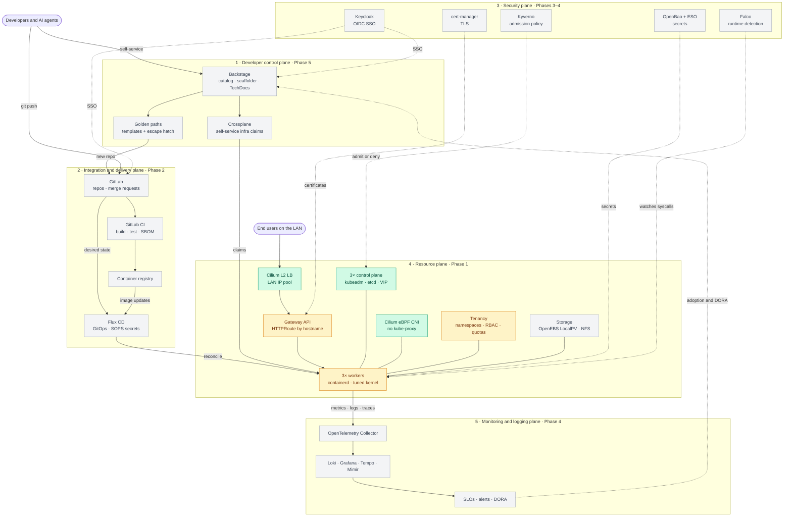

# platform-engineering-bootcamp

Building an internal developer platform from scratch on Kubernetes, one component
at a time, during a Platform Engineering Bootcamp (Oct 2026 – May 2027).

Everything here is my own work. Course slides and instructor material are not published.

Notes are plain Markdown in [`docs/days/`](docs/days/), one page per session, read
directly on GitHub. Start with [Day 1](docs/days/day-01-intro.md).

## The full picture

The platform I'm building, laid out in the five planes of the internal developer platform
reference architecture (platformengineering.org). Each box is colored by my progress.



🟩 built · 🟨 in progress · ⬜ not started

| Plane | What it answers | Bootcamp tools |
|---|---|---|
| Developer control plane | Where do developers start? | Backstage, golden paths, Crossplane |
| Integration and delivery | How does a commit reach the cluster? | GitLab + CI, registry, Flux CD |
| Security | Who is allowed, with which secrets, under which rules? | Keycloak, OpenBao, Kyverno, cert-manager, Falco |
| Resource | Where does it run, and how is it reached? | kubeadm HA, Cilium, Gateway API, storage, tenancy |
| Monitoring and logging | Is it healthy, and is the platform being used? | OpenTelemetry, LGTM, SLOs, DORA |

## Course

The bootcamp runs in phases. Each phase pairs concepts with a hands-on build, and each
day page below has my notes, the commands I ran, and my own thinking on the topic.


⬜ not started · 🟨 in progress · ✅ done

| Status | Phase | Stack | Done when |
|--------|-------|-------|-----------|
| ✅ | 0 · Thinking in platforms | — | I can name the platform's users, value, and scope |
| 🟨 | 1 · Compute foundation | kubeadm, Cilium, OpenEBS, Gateway API | A self-managed cluster is safe to be a platform |
| ⬜ | 2 · Platform control plane | GitLab CI, Flux CD | Everything ships from Git through one delivery loop |
| ⬜ | 3 · Cross-cutting capabilities | cert-manager, Keycloak, OpenBao, Kyverno | Identity, secrets, policy, and TLS reach every workload |
| ⬜ | 4 · Observability and security ops | OpenTelemetry + LGTM, Falco | The platform is measurable and defensible in production |
| ⬜ | 5 · Portal and golden paths | Backstage, Crossplane | A developer self-serves a new service end to end |
| ⬜ | 6 · Operate as a product | DORA, SPACE | The platform survives its own team and keeps its users |
| ⬜ | Capstone | — | One golden path, idea → production, measured |

## Session log

| Day | Date | Topic | Course |
|-----|------|-------|--------|
| 1 | 2026-10-17 | [Intro: what is platform engineering?](docs/days/day-01-intro.md) | — |
| 2 | | [Thinking in platforms](docs/days/day-02-thinking-in-platforms.md) | Phase 0 · lessons 0001–0006 |
| 3 | | [Kubernetes cluster provisioning](docs/days/day-03-k8s-cluster-provisioning.md) | Phase 1 · lessons 0001–0003 |
| 4 | | [Cilium load balancer and kernel tuning](docs/days/day-04-cilium-lb-kernel-tuning.md) | Phase 1 · lessons 0004–0005 |
| 5 | | [Multi-tenancy](docs/days/day-05-multi-tenancy.md) | Phase 1 · lesson 0007 |
| 6 | 2026-11-07 | [Gateway API](docs/days/day-06-gateway-api.md) | Phase 1 · lesson 0012 |
| 7 | 2026-11-08 | [Sizing for production](docs/days/day-07-sizing-for-production.md) | Phase 1 · lesson 0013 |

## Labs

- [`labs/kubeadm-ha/`](labs/kubeadm-ha/) — Phase 1 kubeadm HA cluster on Vagrant.

## Local setup

```bash
direnv allow            # .envrc: bootcamp-only KUBECONFIG at .kube/bootcamp.yaml
mise install            # .mise.toml: pinned kubectl, kind, helm, flux, cilium, kyverno, bao...
colima start --cpu 6 --memory 10 --disk 60
kind create cluster --name bootcamp
kubectl config current-context   # must print kind-bootcamp
```

Inside this repo `kubectl`, `k9s`, `helm` and `flux` only see the bootcamp kubeconfig, so
work clusters are unreachable. Machine-local overrides go in `.envrc.local` (gitignored).

## Working rules

- **Own cluster.** Use a dedicated cluster name (e.g. `kind-bootcamp`) and confirm
  `kubectl config current-context` before every apply. Never point this repo at a work cluster.
- **Notes after doing.** Each session gets a page in `docs/days/`, filled in after the lab from
  `templates/day-notes.md`. Add it to the session log and update the phase status above.
- **No secrets in git.** `pre-commit` runs gitleaks; install with `pre-commit install`.
  OpenBao and Keycloak dev credentials stay in local env files, which are gitignored.
- The GitOps layout (`clusters/`, `infrastructure/`, `apps/`) is added when the FluxCD module starts.
