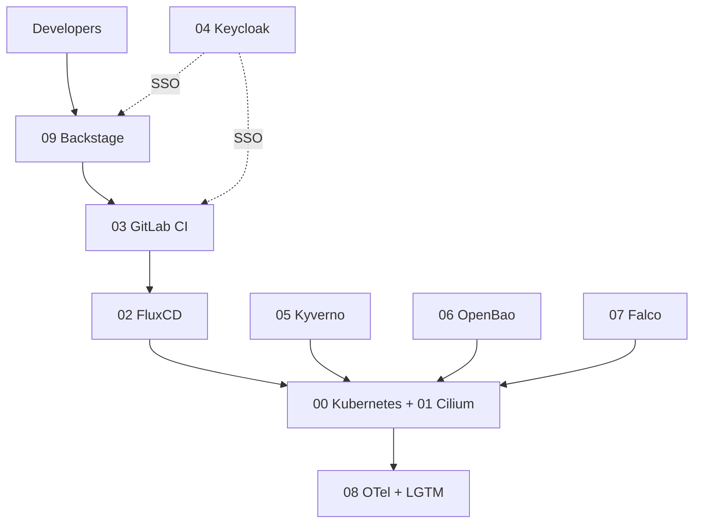

# platform-engineering-bootcamp

Building an internal developer platform from scratch on Kubernetes, one component
at a time, during a Platform Engineering Bootcamp (Oct 2026 – May 2027).

Everything here is my own work. Course slides and instructor material are not published.

Notes are plain Markdown in [`docs/`](docs/), read directly on GitHub. Start with
[What is platform engineering?](docs/00-intro-platform-engineering.md).

## How the platform fits together



## Modules

⬜ not started · 🟨 in progress · ✅ done

| Status | Module | Topic |
|--------|--------|-------|
| ⬜ | [00 · Kubernetes](docs/modules/00-kubernetes.md) | Cluster foundation |
| ⬜ | [01 · Cilium](docs/modules/01-cilium.md) | eBPF networking and service mesh |
| ⬜ | [02 · FluxCD](docs/modules/02-fluxcd.md) | GitOps continuous delivery |
| ⬜ | [03 · GitLab](docs/modules/03-gitlab.md) | Source control and CI |
| ⬜ | [04 · Keycloak](docs/modules/04-keycloak.md) | Identity and SSO |
| ⬜ | [05 · Kyverno](docs/modules/05-kyverno.md) | Policy as code |
| ⬜ | [06 · OpenBao](docs/modules/06-openbao.md) | Secrets management |
| ⬜ | [07 · Falco](docs/modules/07-falco.md) | Runtime security |
| ⬜ | [08 · OpenTelemetry + LGTM](docs/modules/08-otel-lgtm.md) | Loki, Grafana, Tempo, Mimir |
| ⬜ | [09 · Backstage](docs/modules/09-backstage.md) | Developer portal |

Module order follows the component list, not necessarily the session order.

## Labs

- [`labs/kubeadm-ha/`](labs/kubeadm-ha/) — Phase 1 kubeadm HA cluster on Vagrant.

## Local setup

```bash
direnv allow            # .envrc: bootcamp-only KUBECONFIG at .kube/bootcamp.yaml
mise install            # .mise.toml: pinned kubectl, kind, helm, flux, cilium, kyverno, bao...
colima start --cpu 6 --memory 10 --disk 60
kind create cluster --name bootcamp
kubectl config current-context   # must print kind-bootcamp
```

Inside this repo `kubectl`, `k9s`, `helm` and `flux` only see the bootcamp kubeconfig, so
work clusters are unreachable. Machine-local overrides go in `.envrc.local` (gitignored).

## Working rules

- **Own cluster.** Use a dedicated cluster name (e.g. `kind-bootcamp`) and confirm
  `kubectl config current-context` before every apply. Never point this repo at a work cluster.
- **Notes after doing.** Each module page (`docs/modules/`) is filled in after the lab, from
  the template in `templates/`. Update its status in the table above.
- **No secrets in git.** `pre-commit` runs gitleaks; install with `pre-commit install`.
  OpenBao and Keycloak dev credentials stay in local env files, which are gitignored.
- The GitOps layout (`clusters/`, `infrastructure/`, `apps/`) is added when the FluxCD module starts.
