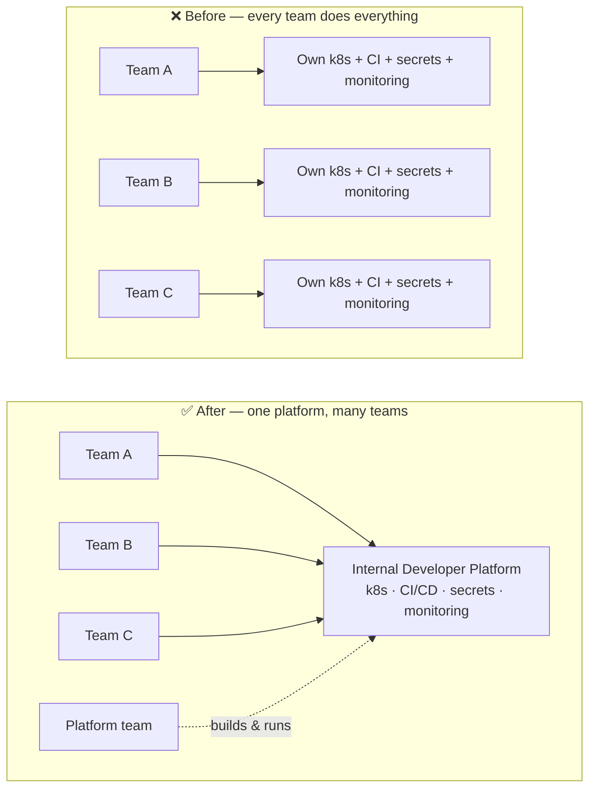
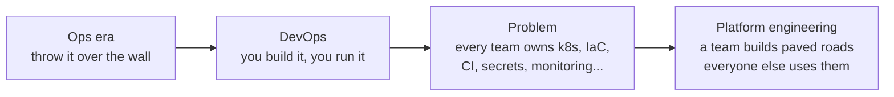
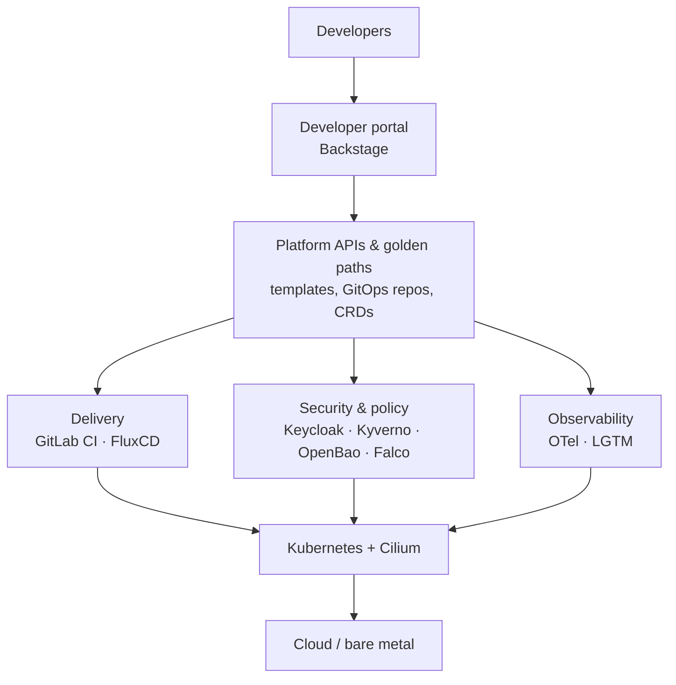
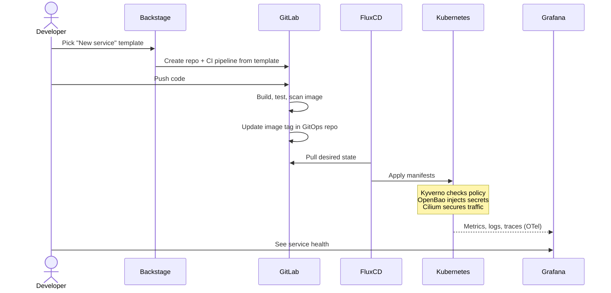
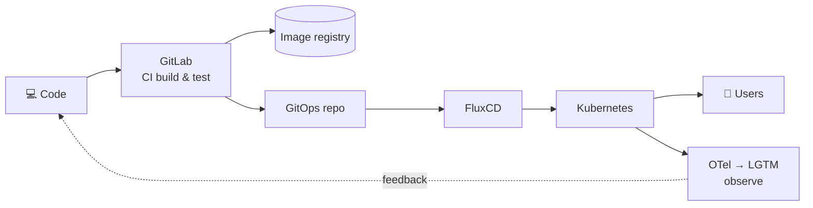

# 00 — Introduction: what is platform engineering?

**Day 1** · 2026-10-17

## One-line definition

Platform engineering is building and running an **Internal Developer Platform (IDP)**:
a self-service product that lets application teams build, ship and run software
without each team having to become experts in Kubernetes, cloud, CI/CD, security
and observability.

> The platform is a **product**, developers are its **customers**, and the goal is
> to reduce their **cognitive load**.

### Explain it like I'm new

Think of a city. Every developer team is a business that needs roads, water and
electricity. Without a city council, every business digs its own well and builds its
own road — slow, expensive, and all different. The **platform team is the city
council**: it builds the shared roads (golden paths) once, so businesses just plug in
and focus on their own work.

### Before vs after

## Why it exists — the problem it solves

- **DevOps** removed the wall between dev and ops, but "you build it, you run it"
  pushed the whole cloud-native toolchain onto every product team.
- The CNCF landscape now has well over 1,000 projects. Teams spent their time on
  plumbing instead of features, and each team solved the same problems differently.
- Platform engineering keeps DevOps culture but **centralises the repeated work**
  into a shared, self-service platform.

DevOps is the *culture*; SRE is a way to run *reliability*; platform engineering is
how you *deliver the tooling* both rely on, as a product.

| | DevOps | SRE | Platform engineering |
|---|---|---|---|
| Focus | Culture & collaboration | Reliability (SLOs, error budgets) | Developer self-service |
| Output | Practices, pipelines | Reliable production | An internal platform (product) |
| Customer | The organisation | End users of the service | Internal developers |

## Key concepts

| Term | Meaning |
|---|---|
| **IDP** — Internal Developer Platform | The whole set of tools, APIs and workflows the platform team provides. |
| **Internal Developer Portal** | The UI front door to the IDP (e.g. Backstage). A portal is *part* of a platform, not the platform. |
| **Golden path / paved road** | The opinionated, supported way to do a common task ("create a new service") — easy to follow, not forced. |
| **Self-service** | Developers get what they need (env, DB, secret, pipeline) without filing a ticket. |
| **Cognitive load** | How much a team must hold in its head. Platforms exist to lower it. |
| **Platform as a Product** | Roadmap, user research, docs, adoption metrics — treat developers as customers. |
| **Thinnest Viable Platform (TVP)** | Start with the smallest platform that helps (even a wiki page), grow it from demand. |
| **Guardrails, not gates** | Security and policy built in by default (policy-as-code) instead of manual approvals. |

## Team Topologies — where the platform team sits

From *Team Topologies* (Skelton & Pais, 2019), the book most platform teams are built on:

- **Stream-aligned team** — builds a product/feature; the platform's customer.
- **Platform team** — provides internal services that stream-aligned teams consume.
- **Enabling team** — coaches teams through new skills.
- **Complicated-subsystem team** — owns a component that needs deep specialism.

Interaction mode between platform and stream teams should mostly be **X-as-a-Service**.

## The building blocks of an IDP

The CNCF *Platforms White Paper* (TAG App Delivery, 2023) lists the capabilities a
platform usually provides. Mapped to this bootcamp:

| Capability | Popular tools | Bootcamp module |
|---|---|---|
| Compute / orchestration | **Kubernetes**, EKS/GKE/AKS | [00](../modules/00-kubernetes/) |
| Networking & service mesh | **Cilium**, Istio, Linkerd | [01](../modules/01-cilium/) |
| GitOps / continuous delivery | **FluxCD**, Argo CD | [02](../modules/02-fluxcd/) |
| Source control & CI | **GitLab**, GitHub Actions, Jenkins | [03](../modules/03-gitlab/) |
| Identity & access | **Keycloak**, Dex, Okta | [04](../modules/04-keycloak/) |
| Policy-as-code | **Kyverno**, OPA Gatekeeper | [05](../modules/05-kyverno/) |
| Secrets | **OpenBao**, HashiCorp Vault, External Secrets Operator | [06](../modules/06-openbao/) |
| Runtime security | **Falco**, Tetragon | [07](../modules/07-falco/) |
| Observability | **OpenTelemetry**, Prometheus, Grafana, Loki, Tempo, Mimir | [08](../modules/08-otel-lgtm/) |
| Developer portal | **Backstage**, Port, Cortex | [09](../modules/09-backstage/) |
| Infrastructure provisioning | Terraform / OpenTofu, Crossplane, Pulumi | — |
| Platform orchestrator | Humanitec, Kratix, KubeVela | — |

Layered view:

## A golden path, step by step

What "self-service" looks like when a developer creates a new service on the platform
this bootcamp builds:

No tickets, no waiting on another team — and security and monitoring come built in.

## Code to production — the big picture

## Industry data points

- **Gartner (2022):** by 2026, **80%** of large software engineering organisations will
  have platform engineering teams, up from **45%** in 2022. Platform engineering has
  appeared on Gartner's top strategic technology trends lists since 2023.
- **Backstage:** created at Spotify, open-sourced 2020, now a CNCF incubating project
  and the most widely adopted open-source developer portal.
- **CNCF** publishes the *Platforms White Paper* (2023) and a *Platform Engineering
  Maturity Model* (2023) — both worth reading this week.
- **DORA / State of DevOps reports** have studied platform engineering since 2023;
  internal platforms are linked to higher team productivity, but a poorly designed
  one can *reduce* delivery throughput at first — product thinking matters.

## How to measure a platform

- **DORA metrics:** deployment frequency, lead time for changes, change failure rate,
  time to restore service.
- **SPACE** framework: satisfaction, performance, activity, communication, efficiency.
- **Adoption:** % of services on the golden path, time-to-first-deploy for a new service,
  number of tickets avoided by self-service.
- **Developer satisfaction:** surveys / NPS — the platform is optional, so usage *is* the score.

## Common anti-patterns

- Building a portal first and calling it a platform.
- Mandating the platform instead of making it the easiest path.
- Rebranding the ops team as "platform" without changing how it works (ticket queue).
- Building for imagined needs instead of talking to developers.
- Too many abstractions — hiding things developers actually need to debug.

## Platform engineer — skills

Linux & networking · containers & Kubernetes · IaC (Terraform/OpenTofu) · CI/CD &
GitOps · cloud (AWS/GCP/Azure) · security (IAM, policy, secrets) · observability ·
scripting (Bash, Python, Go) · **product thinking & communication** — the last one is
what separates a platform engineer from an infrastructure engineer.

## My takeaways

<!-- Fill in after the session: what clicked, what I want to dig into. -->

## References

- CNCF TAG App Delivery — Platforms White Paper: https://tag-app-delivery.cncf.io/whitepapers/platforms/
- CNCF Platform Engineering Maturity Model: https://tag-app-delivery.cncf.io/whitepapers/platform-eng-maturity-model/
- Team Topologies (Skelton & Pais): https://teamtopologies.com/
- platformengineering.org: https://platformengineering.org/
- internaldeveloperplatform.org: https://internaldeveloperplatform.org/
- Backstage: https://backstage.io/
- DORA research: https://dora.dev/
