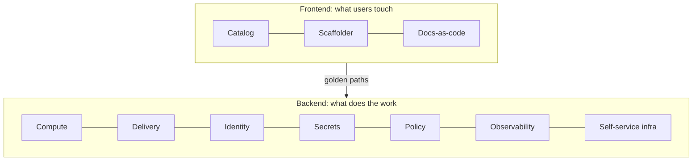

# Day 2 · Thinking in platforms

**Date:** yyyy-mm-dd · **Course:** Phase 0 · **Status:** notes written, charter to draft

No lab today. The whole day was about the mental model: what a platform is, who it is for,
and why it deserves to exist. The deliverable is a one-page **platform charter**.

## Platform engineering vs DevOps vs SRE

All three try to make software delivery faster and safer. They differ in where they put
the responsibility.

| | DevOps | SRE | Platform engineering |
|---|---|---|---|
| Core idea | Shared responsibility: "you build it, you run it" | Reliability as an engineering problem | An internal product that makes other teams faster |
| Team shape | Inside each product team | Central reliability team | A platform team run like a product team |
| Customer | The team's own users | Services under an SLO | Internal engineers |
| Success looks like | Frequent, low-risk deploys | SLOs met, low toil | Adoption and time-to-value |

They are a lineage, not replacements. A mature org runs all three at once.

**The tell for platform engineering:** something is offered to *other* teams as a
self-service product. If five teams have copied one team's deploy script by hand, that
is a golden path waiting to be built, not a problem to ban.

## Cognitive load and Team Topologies

Four team types: **stream-aligned** (owns a product slice), **complicated-subsystem**
(deep specialist area), **platform** (runs shared capabilities as a service) and
**enabling** (coaches a team, then leaves).

Three kinds of load:

- **Intrinsic:** the real work itself, such as the payments domain.
- **Germane:** learning that makes the team better. Keep it.
- **Extraneous:** everything that doesn't need to be there, like renewing certs,
  unsealing secrets or debugging the CNI.

The platform's job is to absorb **extraneous** load. Every ticket, review gate or
approval the platform adds is new load, so judge the net effect.

## Users and value

"The platform serves developers" is too vague to build from. Write users as personas with
jobs-to-be-done:

> *When I* need a new service, *I want* a repo, pipeline and deploy path right away,
> *so I* can try my idea this afternoon.

The value is time and safety, stated as numbers you can check:
- Time to first production change for a new service or a new joiner.
- Compliance by default: the paved path is the audited path.
- Fewer decisions per service for product teams.

## CNCF definition and maturity model

CNCF white-paper definition: a platform is *an integrated collection of capabilities
defined and presented according to the needs of the platform's users*. Platforms
should be optional and composable (escape hatches exist), secure by default, observable,
and documented.

| Level | Name | How you recognise it |
|---|---|---|
| 0 | Provisional | Snowflake scripts, "ask Sam" |
| 1 | Operational | One leading platform, side doors remain |
| 2 | Scalable | Golden paths are self-service and repeatable |
| 3 | Sustainable | Capabilities run as products with feedback loops |
| 4 | Fully operational | Multi-team, measured, strategic |

The classic mistake is jumping to level 2 (self-service scaffolding) before one path is
boring at level 1.

## Anatomy of an IDP

A frontend without a backend is a wiki. A backend without a frontend is a shelf of CLIs.
A golden path joins them and always keeps an escape hatch.

## Where the field is heading: IDP to AEP

The next shift is the **agentic engineering platform**, which serves humans *and* AI agents.
Agents move up a ladder: assist, then delegate (with approval), then guardrail (agents own
paths and policy decides), then routine users of the platform. For an agent to be safe at the
guardrail rung, the platform needs machine-readable APIs, admission policy you actually trust,
full audit trails and versioned golden paths. A bad agent change should be rejected loudly,
not merged quietly.

## My thinking

- **The extraneous-load test is the most useful tool from today.** For every capability, ask
  "who carries this today, by name?" If I can't name them, the capability isn't real yet.
- **Policy becomes the contract.** In the agent future, admission control (Kyverno in
  Phase 3) stops being a nice guardrail and becomes the thing that makes automation safe.
  That's a reason to take Phase 3 seriously.
- **Measure adoption, not uptime.** A platform with 99.99% uptime that nobody uses has
  failed. Track share of new services on the path, and time to first production change.
- **Watch for golden cages.** Absorbing a team's *intrinsic* load "to be helpful" takes
  away the work that makes them good at their job.

## My platform charter (v0)

<!-- Fill in: one page, no more. -->

- **Users:** <!-- 2–3 personas with jobs-to-be-done -->
- **Value:** <!-- the time or safety outcome for each job -->
- **Scope:** <!-- three capabilities or fewer -->
- **Non-goals:** <!-- what teams keep doing themselves -->
- **Metrics:** <!-- adoption and time-to-value -->
- **Maturity today:** <!-- one level, with evidence -->

## References

- CNCF Platforms White Paper: https://tag-app-delivery.cncf.io/whitepapers/platforms/
- CNCF Platform Engineering Maturity Model: https://tag-app-delivery.cncf.io/whitepapers/platform-eng-maturity-model/
- Team Topologies: https://teamtopologies.com/
