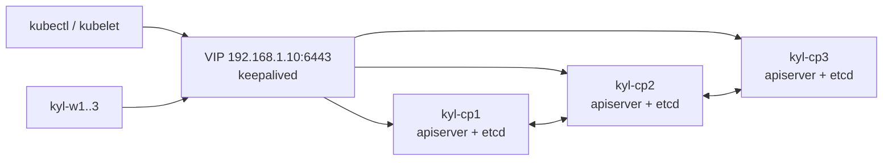

# Day 3 · Kubernetes cluster provisioning

**Date:** yyyy-mm-dd · **Course:** Phase 1, lessons 0001–0003 · **Status:** built in the lab

**Lab:** [kubeadm HA lab](../../labs/kubeadm-ha/README.md), lessons 0001–0003

**Win:** six nodes joined, etcd 3/3, the API answering on the VIP, all nodes `Ready`, and
Cilium's connectivity test green.

## What I built

Six Ubuntu 26.04 VMs bridged onto the home LAN: three control planes with stacked etcd
behind a keepalived VIP, three workers, and Cilium as the CNI with **no kube-proxy**.



## How it works

### 1. Host preparation (every node, identically)

| Step | Why |
|---|---|
| Static IP outside the DHCP pool, every node in `/etc/hosts` | Names resolve before cluster DNS exists |
| `chrony` | kubeadm and etcd fail when clocks drift |
| Swap off, also in `/etc/fstab` | kubelet requires it |
| `overlay` + `br_netfilter` modules, `ip_forward=1` | Pod networking and bridged traffic through netfilter |
| containerd with `SystemdCgroup = true` | Must match kubelet's cgroup driver on cgroup v2 |
| `apt-mark hold` containerd, kubelet, kubeadm, kubectl | An unattended upgrade must not move the runtime under a running cluster |

### 2. HA control plane

- **keepalived starts before `kubeadm init`**, so the VIP already exists when the first
  apiserver comes up. Its health check `curl`s the local apiserver. If that fails, the node's
  priority drops and the VIP moves to another control plane.
- `kubeadm init --control-plane-endpoint kyl-vip:6443 --upload-certs --skip-phases=addon/kube-proxy`
  - The **endpoint is the VIP, never a node**. Nothing in the cluster should name an
    individual control plane.
  - `--upload-certs` shares the control-plane certs, so the other two can join with
    `--certificate-key`.
  - kube-proxy is skipped because Cilium replaces it.
- Workers join the same VIP without `--control-plane`.
- All nodes `NotReady` at this point is **expected**: there's no CNI yet.

### 3. Cilium without kube-proxy

```bash
helm install cilium cilium/cilium --version 1.20.3 -n kube-system \
  --set kubeProxyReplacement=true \
  --set k8sServiceHost=192.168.1.10 --set k8sServicePort=6443
cilium status --wait
```

- `kubeProxyReplacement=true` is **strict**: if the kernel lacks a feature, the agent refuses
  to start instead of silently falling back. That's what I want.
- `k8sServiceHost` **must be the VIP IP**. Without kube-proxy the agent can't use the
  `kubernetes` Service to find the API, and it starts before CoreDNS.

## Verify

```bash
kubectl get nodes                                   # 6 Ready
kubectl -n kube-system exec etcd-kyl-cp1 -- sh -c 'ETCDCTL_API=3 etcdctl \
  --cacert /etc/kubernetes/pki/etcd/ca.crt --cert /etc/kubernetes/pki/etcd/server.crt \
  --key /etc/kubernetes/pki/etcd/server.key member list -w table'   # 3 started
kubectl get --raw /healthz                          # ok
cilium status                                       # KubeProxyReplacement: True
kubectl -n kube-system exec ds/cilium -- cilium-dbg status | grep KubeProxyReplacement
cilium connectivity test                            # all green
```

## Gotchas

- **cgroup driver mismatch** on one node shows up later as join failures. Fix it before
  `kubeadm init`.
- **Join tokens last 24h, and the uploaded certs last only 2h.** Re-mint with
  `kubeadm token create --print-join-command` and
  `kubeadm init phase upload-certs --upload-certs`.
- **Two nodes holding the VIP** means `virtual_router_id` differs between them.
- **Nodes stay `NotReady` after installing Cilium:** usually `k8sServiceHost` points at one
  node instead of the VIP.
- **CoreDNS stuck `Pending`:** it was scheduled before the CNI existed.
  `kubectl -n kube-system rollout restart deploy coredns`.
- In my lab: Cilium's default pod pool `10.0.0.0/8` overlaps the VirtualBox NAT network, so
  I use `ipam.mode: kubernetes`.

## My thinking

- **Stacked vs external etcd.** Stacked etcd means fewer machines, but losing a control-plane
  node costs both an apiserver *and* an etcd member. With 3 members, quorum is 2, so I can
  lose exactly one node. External etcd separates those failure domains but doubles the
  number of machines. Stacked is the right call for a lab and most on-prem clusters.
- **etcd cares about disk fsync latency, not CPU.** On real hardware, give it SSDs before
  you give it cores.
- **keepalived vs kube-vip.** keepalived is plain, well-understood Linux. kube-vip does
  the same job as a static pod, so it's managed with the cluster. Its downside is that the
  VIP then depends on kubelet being healthy. I'd keep keepalived for the API VIP.
- **The course's `auth_type PASS` adds no security.** The VRRP password is sent in clear
  text on the LAN. My lab uses unicast VRRP with no password, which is just as honest. The
  real protection is that the LAN itself is trusted.
- **Compared with managed Kubernetes (EKS):** every row of the host-prep table above is
  something the cloud provider does for me. Doing it by hand shows what the "managed" in
  managed Kubernetes actually covers.

## References

- kubeadm HA topology: https://kubernetes.io/docs/setup/production-environment/tools/kubeadm/ha-topology/
- Creating HA clusters with kubeadm: https://kubernetes.io/docs/setup/production-environment/tools/kubeadm/high-availability/
- Cilium kube-proxy replacement: https://docs.cilium.io/en/stable/network/kubernetes/kubeproxy-free/
