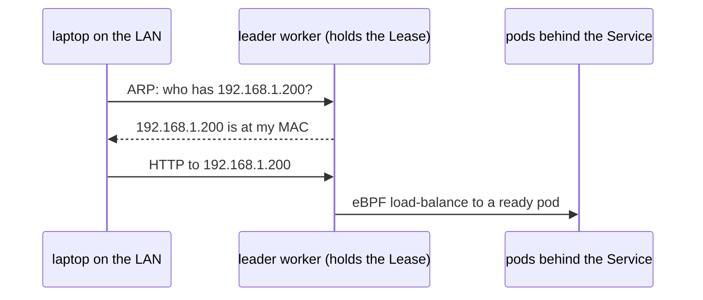

# Day 4 · Cilium load balancer and kernel tuning

**Date:** yyyy-mm-dd · **Course:** Phase 1, lessons 0004–0005 · **Status:** LB built in the lab, tuning not in the lab yet

**Lab:** [kubeadm HA lab](../../labs/kubeadm-ha/README.md), lesson 0004

**Win:** `curl` a `LoadBalancer` IP from another machine on the LAN, and kernel tuning that
survives a reboot.

## Part 1: The LAN-facing load balancer

On-prem there's no cloud load balancer to ask for an IP. Cilium fills that gap with two
features:

- **LB IPAM**: a pool of LAN addresses that Cilium hands to `type: LoadBalancer` Services.
- **L2 announcements**: one node wins a Lease for each Service IP, answers ARP for it, then
  load-balances to the pods with eBPF.



### Config

```yaml
# Helm values: l2announcements.enabled=true, plus a higher k8sClientRateLimit,
# because every announced IP is a Lease that has to be renewed constantly.
apiVersion: cilium.io/v2
kind: CiliumLoadBalancerIPPool
metadata: { name: lan-pool }
spec:
  blocks:
    - cidr: 192.168.1.200/29          # .200–.207, outside DHCP
---
apiVersion: cilium.io/v2alpha1
kind: CiliumL2AnnouncementPolicy
metadata: { name: l2-policy }
spec:
  nodeSelector:                        # workers only: keep data traffic off control planes
    matchExpressions:
      - { key: node-role.kubernetes.io/control-plane, operator: DoesNotExist }
  interfaces: ["^enp1s0$"]
  loadBalancerIPs: true
```

### Verify

```bash
kubectl create deployment hello --image=nginx --replicas=3
kubectl expose deployment hello --type=LoadBalancer --port=80
kubectl get svc hello                                # EXTERNAL-IP from the pool
curl -s http://192.168.1.200 | head -4               # from the laptop, not a node
kubectl -n kube-system get leases | grep l2announce  # who answers ARP
```

### Gotchas

- **`EXTERNAL-IP <pending>`**: no pool matched the Service, the pool is exhausted, or the
  Service sets a `loadBalancerClass`.
- **IP assigned but unreachable**: no L2 policy selected the Service, or the interface
  regex doesn't match the NIC. In my lab every VM also has a NAT adapter, so the regex
  matters.
- **Keep `externalTrafficPolicy: Cluster`.** With `Local`, traffic drops whenever the leader
  node has no pod for the Service.
- **A few seconds of outage when the leader reboots**: that's the Lease failing over.
  `l2announcements.leaseDuration` trades failover time against API load.

## Part 2: Node and kernel tuning

Default Linux limits suit a box running a few services, not a node running hundreds of
pods. What matters is making the change **persistent**: values written to files survive a
reboot, `sysctl -w` doesn't.

| Knob | Problem at default | Course value |
|---|---|---|
| `net.netfilter.nf_conntrack_max` | Table fills, new connections dropped | `1000000` |
| `net.core.somaxconn`, `net.ipv4.tcp_max_syn_backlog` | Accept queue overflows under bursts | `32768`, `8192` |
| `fs.inotify.max_user_instances` / `max_user_watches` | "too many open files" from config watchers | `8192` / `524288` |
| `fs.file-max` | Node-wide fd ceiling | `2097152` |
| `net.core.rmem_max` / `wmem_max` | Small socket buffers throttle fast links | `16777216` |
| journald `SystemMaxUse` | Logs fill the disk | `2G` |

```bash
# /etc/sysctl.d/99-tuning.conf   then: sudo sysctl --system
# /etc/security/limits.d/99.conf (nofile 1048576)
# /etc/systemd/journald.conf.d/99.conf (SystemMaxUse=2G, SystemMaxFileSize=200M)
sudo systemctl disable --now unattended-upgrades     # on workers
sudo apt-mark hold kubelet kubeadm containerd
```

**Proving it:** reboot the node, re-check `sysctl net.netfilter.nf_conntrack_max`, and the
node must come back `Ready` without anyone touching it.

### Gotchas

- **`nf_conntrack_max` silently not applied**: the `nf_conntrack` module wasn't loaded
  yet. Add it to `/etc/modules-load.d/`.
- **Values back to default after reboot**: they were set with `sysctl -w` instead of a file.
- **Node doesn't come back**: check `systemctl status kubelet containerd keepalived`.

## My thinking

- **Don't copy the course table onto my lab VMs.** They have 3 GB RAM. One conntrack
  entry is roughly 300 bytes, so a full 1M-entry table is about 300 MB, a tenth of the VM.
  Size the values to the memory you actually have.
- **With Cilium's kube-proxy replacement, `nf_conntrack` matters less than it looks.**
  Cilium tracks Service and pod connections in its own eBPF tables, which are sized by
  Cilium's `bpf.*` settings, not by `nf_conntrack_max`. Netfilter conntrack still covers
  host-network traffic. So in this cluster, tuning the "conntrack limit" means checking
  Cilium's map sizes too.
- **`limits.d` only applies to PAM login sessions.** containerd and kubelet are systemd
  services and take their limits from `LimitNOFILE` in their unit files. Containers inherit
  from containerd. So `limits.d` changes what my SSH shell sees, not what pods see. To
  check, run `ulimit -n` inside a pod.
- **Disabling unattended upgrades swaps one risk for another.** It stops surprise reboots
  but also stops security patches. A better production pattern is patching on a schedule
  with controlled reboots, one node at a time, drained first (e.g. kured).
- **L2 announcements fit a lab or a small site.** One node takes all the traffic for a
  given IP, so there's no real load spreading across nodes. Bigger sites use BGP
  (Cilium's BGP control plane) so the router spreads traffic over ECMP.

## Lab TODO

- [ ] Add a lab script that writes the sysctl, limits and journald files, sized for 3 GB VMs.
- [ ] Reboot a worker and confirm the values persist and the node rejoins.

## References

- Cilium LB IPAM: https://docs.cilium.io/en/stable/network/lb-ipam/
- Cilium L2 announcements: https://docs.cilium.io/en/stable/network/l2-announcements/
- Kubernetes sysctls: https://kubernetes.io/docs/tasks/administer-cluster/sysctl-cluster/
