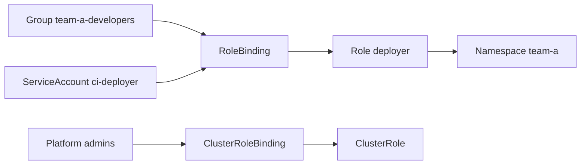

# Day 5 · Multi-tenancy

**Date:** yyyy-mm-dd · **Course:** Phase 1, lesson 0007 · **Status:** notes written, lab to do

**Win:** a least-privilege team namespace. The team's identity gets `yes` inside its
namespace and `no` everywhere else.

## The model

Namespaces split the cluster into rooms. RBAC decides who can open which door.

| Object | Scope | Answers |
|---|---|---|
| Namespace | cluster | Where does this team's work live? |
| Role | namespace | What can be done inside this room? |
| RoleBinding | namespace | Who gets that Role here? |
| ClusterRole | cluster | What can be done cluster-wide (nodes, PVs, namespaces)? |
| ClusterRoleBinding | cluster | Who gets cluster-wide powers? |
| ServiceAccount | namespace | Which identity does a workload or pipeline use? |



## Steps

```yaml
apiVersion: v1
kind: Namespace
metadata:
  name: team-a
  labels:                 # labels are how cost reports and policy find the team later
    team: team-a
    cost-center: "1001"
---
apiVersion: rbac.authorization.k8s.io/v1
kind: Role
metadata: { namespace: team-a, name: deployer }
rules:
  - apiGroups: ["apps"]
    resources: ["deployments", "replicasets"]
    verbs: ["get", "list", "watch", "create", "update", "patch", "delete"]
  - apiGroups: [""]
    resources: ["pods", "services", "configmaps"]
    verbs: ["get", "list", "watch", "create", "update", "patch", "delete"]
```

```bash
kubectl -n team-a create serviceaccount ci-deployer
kubectl -n team-a create rolebinding ci-deployer --role=deployer --serviceaccount=team-a:ci-deployer
kubectl -n team-a create rolebinding team-a-devs --role=deployer --group=team-a-developers
```

## Verify

Test from the cluster's point of view by impersonating the identity:

```bash
SA=system:serviceaccount:team-a:ci-deployer
kubectl auth can-i create deployments --as=$SA -n team-a     # yes
kubectl auth can-i create deployments --as=$SA -n default    # no
kubectl auth can-i get nodes --as=$SA                        # no
kubectl auth can-i --list --as=$SA -n team-a                 # the full picture
```

## Gotchas

- **Bind groups, not users.** People come and go. Let the identity provider own group
  membership (Keycloak in Phase 3).
- **Never hand out `cluster-admin` because a Role was fiddly.** If a team needs something
  cluster-wide, that's a platform capability to build, not a binding to give away.
- **Pipeline ServiceAccounts stay namespace-local.** A leaked token then breaks one room,
  not the whole building.

## My thinking

- **"No secrets access" in this Role isn't really true.** Anyone who can `create pods` in
  a namespace can mount any Secret in that namespace into a pod and read it, and can run
  that pod as any ServiceAccount there. `create pods` effectively includes read on Secrets
  and the namespace's SA permissions. The real boundary is the **namespace**, not the verb
  list. Keep secrets for different trust levels in different namespaces.
- **RBAC alone isn't multi-tenancy.** It controls the API, not the network or the node.
  For a team namespace to be a real tenant it also needs:
  - **Network isolation:** default-deny `CiliumNetworkPolicy` per namespace. Without it,
    any pod can reach any other team's pods.
  - **Pod Security Admission:** label the namespace
    `pod-security.kubernetes.io/enforce: restricted` so a team can't run privileged pods
    or use hostPath to escape onto the node.
  - **Quotas and LimitRanges:** so one team can't starve the others (the next lesson).
- **Soft vs hard multi-tenancy.** Namespaces give *soft* tenancy: fine for teams in the
  same company who trust each other somewhat. Hostile tenants (customers, untrusted code)
  need separate clusters or virtual clusters (vcluster).
- **Write the namespace as a template.** Namespace + labels + RoleBindings + NetworkPolicy
  + PSA + quota is the first golden path the platform will vend. In Phase 2 it becomes one
  Flux-managed folder per team.

## Lab TODO

- [ ] Create `team-a` and `team-b` with the Role above and prove `can-i` both ways.
- [ ] Add a default-deny CiliumNetworkPolicy and show team-a can't reach team-b.
- [ ] Label both namespaces with PSA `restricted` and show a privileged pod is rejected.

## References

- RBAC: https://kubernetes.io/docs/reference/access-authn-authz/rbac/
- RBAC good practices (privilege escalation paths): https://kubernetes.io/docs/concepts/security/rbac-good-practices/
- Multi-tenancy: https://kubernetes.io/docs/concepts/security/multi-tenancy/
- Pod Security Admission: https://kubernetes.io/docs/concepts/security/pod-security-admission/
