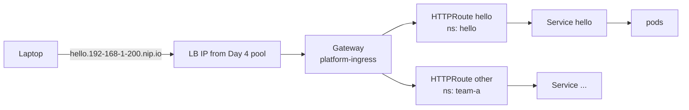

# Day 6 · Gateway API

**Date:** 2026-11-07 · **Course:** Phase 1, lesson 0012 · **Status:** in progress

**Lab:** [kubeadm HA lab](../../labs/kubeadm-ha/README.md), section "Ingress: Envoy Gateway"

**Win:** `curl` by *hostname* from the laptop reaches the `hello` pod through the Gateway,
and the app team attached its route without asking the platform team.

## Why

Day 4 gave Services *IP addresses*. Users type *names*, over HTTPS, with paths. The
Gateway API is the official successor to Ingress. Instead of controller-specific
annotations, it splits ownership by role.

| Object | Owner | What it is |
|---|---|---|
| `GatewayClass` | Infra / controller | "Gateways of this kind are run by controller X" |
| `Gateway` | Platform team | The front door: listeners, ports, an IP from the LB pool, TLS |
| `HTTPRoute` | App team | Hostname + path rules to a Service, attached with `parentRefs` |

The platform team creates the front door once. Teams then attach routes on their own.



## Steps (course: Cilium as the Gateway controller)

```bash
# 1. CRDs first, pinned (standard channel)
kubectl apply -f https://github.com/kubernetes-sigs/gateway-api/releases/download/v1.5.0/standard-install.yaml
# 2. Then enable Cilium's implementation
helm upgrade cilium cilium/cilium --version 1.20.3 -n kube-system --reuse-values --set gatewayAPI.enabled=true
kubectl get gatewayclass            # cilium   io.cilium/gateway-controller
```

```yaml
apiVersion: gateway.networking.k8s.io/v1
kind: Gateway
metadata: { name: lab-gateway, namespace: platform-ingress }
spec:
  gatewayClassName: cilium
  listeners:
    - name: http
      protocol: HTTP
      port: 80
      allowedRoutes:                       # see "My thinking": the default is Same
        namespaces:
          from: Selector
          selector:
            matchLabels: { gateway-access: "true" }
---
apiVersion: gateway.networking.k8s.io/v1
kind: HTTPRoute
metadata: { name: hello, namespace: hello }
spec:
  parentRefs:
    - { name: lab-gateway, namespace: platform-ingress }
  hostnames: ["hello.192-168-1-200.nip.io"]   # nip.io resolves to 192.168.1.200
  rules:
    - backendRefs: [{ name: hello, port: 80 }]
```

## Verify

```bash
kubectl -n platform-ingress get gateway lab-gateway     # PROGRAMMED True, ADDRESS from pool
kubectl -n hello get httproute hello -o jsonpath='{.status.parents[0].conditions}' | jq
#   Accepted=True and ResolvedRefs=True
curl -s http://hello.192-168-1-200.nip.io | head -1      # from the laptop
```

## Gotchas

- **Gateway stuck `Pending`**: no free IP in the pool, or no L2 policy (Day 4).
- **No `cilium` GatewayClass**: the CRDs went in *after* Cilium restarted. Order matters:
  CRDs first, then the flag.
- **404 from the Gateway**: the Gateway works but no hostname matched. Hostnames are exact
  (`www.` is a different host).
- **Route never `Accepted`**: wrong `parentRef` namespace, *or* the listener doesn't allow
  routes from that namespace (below).
- **Version drift**: CRDs change between minors, and each controller supports specific
  Gateway API versions. Upgrade both together.

## My thinking

- **The course's Gateway won't accept the `hello` route as written.** A listener without
  `allowedRoutes` defaults to `namespaces.from: Same`, so it only accepts routes from its
  own namespace. The Gateway lives in `platform-ingress` and the route in `hello`, so the
  route shows `Accepted=False` (`NotAllowedByListeners`). Fix this with `allowedRoutes`.
- **`from: All` is too open for a shared cluster.** My lab's Envoy Gateway uses `All`, which
  lets any namespace claim any hostname on the shared front door. One team could hijack
  another team's hostname. The multi-tenant choice is `from: Selector` with a namespace label
  such as `gateway-access: "true"`. That ties straight back to Day 5: the team namespace
  template sets the label, so the platform still decides who can attach.
- **Cilium Gateway vs Envoy Gateway (what my lab runs).**

  | | Cilium Gateway API | Envoy Gateway |
  |---|---|---|
  | Data path | Cilium's own (embedded Envoy per node) | A separate Envoy Deployment per Gateway |
  | Extra components | None, just a Helm flag | Controller + Envoy pods |
  | Scaling the proxy | Runs on every node with Cilium | Scale the Envoy Deployment on its own |
  | Extras | Fewer policy CRDs | Rich policies: rate limits, auth, retries (`BackendTrafficPolicy`, `SecurityPolicy`) |

  Cilium means one less moving part. Envoy Gateway gives more traffic-policy features and is
  closer to what I run at work. For the course I'll try Cilium's, and keep Envoy Gateway as
  the comparison.
- **TLS is the next step.** Phase 3 adds cert-manager and a real domain, and TLS terminates
  at this same Gateway. The listener changes to HTTPS with `certificateRefs`. Cross-namespace
  certificate references need a `ReferenceGrant`.
- **Cross-namespace backends need a `ReferenceGrant`** in the backend's namespace. That stops
  a route in one namespace from pointing at another team's Service without permission.

## Lab TODO

- [ ] Restrict my Envoy Gateway listener from `All` to a namespace `Selector`.
- [ ] Try Cilium's GatewayClass alongside it (`gatewayAPI.enabled: true`) and compare.
- [ ] Show a route from an unlabelled namespace is rejected (`NotAllowedByListeners`).

## References

- Gateway API: https://gateway-api.sigs.k8s.io/
- Cross-namespace routing: https://gateway-api.sigs.k8s.io/guides/multiple-ns/
- Cilium Gateway API: https://docs.cilium.io/en/stable/network/servicemesh/gateway-api/gateway-api/
- Envoy Gateway: https://gateway.envoyproxy.io/
