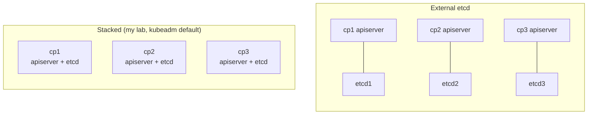
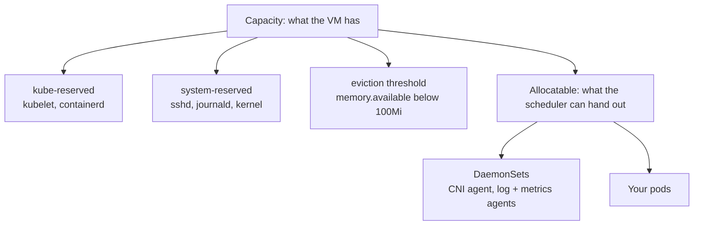

# Day 7 · Sizing for production

**Date:** 2026-11-08 · **Course:** Phase 1 · **Status:** in progress

**Lab:** [kubeadm HA lab](../../labs/kubeadm-ha/README.md), measured in place (no new build)

**Win:** I can justify a control-plane count, a worker shape and a node count from numbers,
and my lab shows what kubeadm actually leaves for pods.

## Why

Sizing is three separate questions:

1. **How many control planes**: decided by etcd quorum.
2. **What shape of worker**: decided by the CPU-to-memory ratio of the workloads' requests.
3. **How many workers**: decided by summed requests, plus headroom to lose a node or a zone.

A cluster is a restaurant. The control plane is the kitchen office: it takes orders and
keeps the books, and three managers who must agree (etcd quorum) beat one who can fall ill.
The workers are the tables. You size by how many seats were *booked* (requests), not by
how hungry people are (usage), and you keep spare tables in case one breaks.

## Control planes: count first, then size

### How many: etcd quorum

etcd accepts a write only when a majority (`n/2 + 1`) of members agree.

| Members | Quorum | Failures tolerated | Use it for |
|---|---|---|---|
| 1 | 1 | 0 | Labs only |
| 2 | 2 | **0** | Never: worse than 1, two things to break |
| **3** | 2 | **1** | Default for production |
| 4 | 3 | 1 | Never: same tolerance as 3, slower writes |
| **5** | 3 | **2** | Large or critical clusters, or 1 failure during maintenance |
| 7 | 4 | 3 | Rarely worth the write latency |

Always an **odd** number. Every extra member is another replica each write waits on, so
more members buy resilience, not capacity. Spread members across failure domains:
**3 zones for 3 members**. With 3 members in 2 zones, losing the zone with 2 loses quorum.

### Stacked or external etcd



- **Stacked**: 3 machines, simple. Losing a node loses an apiserver *and* an etcd member,
  and the two share a disk.
- **External**: 6 machines, more to run. etcd gets its own disks and can be sized and
  upgraded on its own. Worth it once etcd disk latency is the bottleneck.

### How big

Control-plane load grows with **nodes, pods and API calls** (controllers, operators, CI,
watches), not with how busy the apps are.

| Cluster size | Control-plane node (rule of thumb) |
|---|---|
| ≤ 10 nodes | 2 vCPU / 8 GiB |
| 11–100 nodes | 4 vCPU / 16 GiB |
| 101–250 nodes | 8 vCPU / 32 GiB |
| 251–500 nodes | 16 vCPU / 64 GiB |
| > 500 nodes | 32+ vCPU, external etcd, tuned API priority and fairness |

This is the node-count table the old `kube-up` scripts used, rounded to common instance
shapes. A starting point: measure, then resize.

**etcd cares about disk more than anything else.**

- SSD/NVMe only. Every write waits for an `fsync` of the write-ahead log.
- p99 WAL fsync should stay **under 10 ms**. Above that, leader elections flap and the API
  slows down.
- The default database quota is **2 GiB** (`--quota-backend-bytes`). At the quota etcd
  raises a `NOSPACE` alarm and goes **read-only**. The documented ceiling is 8 GiB.

Upstream's tested limits for one cluster: **5,000 nodes, 110 pods per node, 150,000 pods,
300,000 containers.** Undersized control planes hit trouble long before that.

## Workers: shape, then count

### What a node really gives you



`allocatable = capacity − kube-reserved − system-reserved − eviction threshold`

**kubeadm reserves nothing** by default. Only the 100 Mi eviction threshold comes off, so
the scheduler packs pods into memory the kubelet and OS also need, and the node OOMs or
evicts under load. Production nodes need `kubeReserved` and `systemReserved` set.

GKE's formula is a reasonable one to copy:

| Memory reserved | | CPU reserved | |
|---|---|---|---|
| first 4 GiB | 25% | first core | 6% |
| next 4 GiB | 20% | second core | 1% |
| next 8 GiB | 10% | cores 3–4 | 0.5% each |
| next 112 GiB | 6% | above 4 cores | 0.25% each |
| above 128 GiB | 2% | | |

Plus 100 Mi for eviction. A 4 GiB node keeps about 1.1 GiB for itself, over a quarter. A
32 GiB node keeps about 3.7 GiB, around 11%.

### Big nodes or small nodes

| | Fewer, bigger nodes | More, smaller nodes |
|---|---|---|
| Overhead (reserved + DaemonSets) | Smaller share | Bigger share |
| Bin packing large pods | Easier | Large pods may not fit |
| Losing one node | Big blast radius, slow drain | Small blast radius |
| Pods per node | Can hit `maxPods` (110) or the IP limit first | Rarely |
| Autoscaling step | Coarse, more waste | Fine-grained |

The middle ground for most clusters: **8–16 vCPU nodes**, at least 3 per zone.

### Match the node shape to the workload

Add up the workloads' **requests**. Their CPU-to-memory ratio picks the node shape. If pods
ask for 1 vCPU per 2 GiB and nodes offer 1:4, CPU runs out with half the memory stranded,
and you still pay for it.

## Capacity planning

The scheduler places pods by **requests**, never by usage. Plan on requests, then check
usage to see whether the requests are honest.

```
nodes = ceil( total requests / (allocatable per node × target utilisation) )
        then round up so losing one zone (or one node) still fits total requests
```

- **Target utilisation** around **70%** of allocatable leaves room for rollout surge, HPA
  scale-out and a failed node's pods.
- **N+1**: with one node gone, the rest still hold every request.
- **Zone-aware**: with 3 zones, keep the node count a multiple of 3 and check that two
  zones carry the lot.

### Worked example

300 pods averaging **250m CPU and 512 Mi** of requests: **75 vCPU and 150 GiB**, a 1:2
ratio. DaemonSets take about 300m / 0.5 GiB per node. 3 zones, 70% target.

| | **A: 8 vCPU / 32 GiB (1:4)** | **B: 16 vCPU / 32 GiB (1:2)** |
|---|---|---|
| Allocatable after reserves | 7.91 vCPU / 28.3 GiB | 15.89 vCPU / 28.3 GiB |
| After DaemonSets | 7.61 / 27.8 | 15.59 / 27.8 |
| Nodes for CPU at 70% | 75 / 5.33 → **15** | 75 / 10.91 → 7 |
| Nodes for memory at 70% | 150 / 19.5 → 8 | 150 / 19.5 → **8** |
| Rounded to a multiple of 3 | 15 | 9 |
| One zone lost | 10 nodes: 76 vCPU for 75. Only just | 6 nodes: 94 vCPU / 167 GiB. Fits |
| Memory left idle | ~64% | ~40% |

Shape B needs **9 nodes instead of 15**, survives a zone outage with room to spare, and
strands far less memory. The ratio decided it, not the node size. The control plane for
this cluster: 3 × 4 vCPU / 16 GiB with SSDs, one per zone.

### Keep it honest over time

| Watch | PromQL | Act when |
|---|---|---|
| Requests vs allocatable | `sum(kube_pod_container_resource_requests{resource="cpu"}) / sum(kube_node_status_allocatable{resource="cpu"})` | Above 0.7: add nodes |
| Usage vs requests | `sum(rate(container_cpu_usage_seconds_total{container!=""}[5m])) / sum(kube_pod_container_resource_requests{resource="cpu"})` | Far below 1: rightsize |
| Pending pods | `sum(kube_pod_status_phase{phase="Pending"})` | Above 0 for minutes |
| etcd disk | `histogram_quantile(0.99, rate(etcd_disk_wal_fsync_duration_seconds_bucket[5m]))` | Above 10 ms |
| etcd file vs live data | `etcd_mvcc_db_total_size_in_bytes` vs `etcd_mvcc_db_total_size_in_use_in_bytes` | File above ~70% of quota, or live data under half the file: defrag |
| API overload | `rate(apiserver_flowcontrol_rejected_requests_total[5m])` | Above 0 |

For growth, take the requests trend over the last quarter, project it forward, and buy
ahead of the hardware lead time. In the cloud an autoscaler or Karpenter covers the short
term, but the **maximum** node count and the budget behind it are still a planning decision.

## Verify (on the Phase 1 lab)

The lab runs 3 control planes at 2 vCPU / 3 GiB and 3 workers at 2 vCPU / 4 GiB:
lab-sized on purpose.

```bash
# 1. Capacity vs allocatable: expect only 100 Mi difference (kubeadm reserves nothing)
kubectl get nodes -o custom-columns=NODE:.metadata.name,\
CPU:.status.capacity.cpu,ALLOC_CPU:.status.allocatable.cpu,\
MEM:.status.capacity.memory,ALLOC_MEM:.status.allocatable.memory
kubectl get --raw /api/v1/nodes/kyl-w1/proxy/configz \
  | jq '.kubeletconfig | {kubeReserved, systemReserved, evictionHard, maxPods}'

# 2. What's already booked (kubectl top needs metrics-server, not installed yet)
kubectl describe nodes | grep -A8 "Allocated resources"

# 3. etcd size, live data, leader; then fsync from the metrics port kubeadm sets
E='etcdctl --cacert /etc/kubernetes/pki/etcd/ca.crt --cert /etc/kubernetes/pki/etcd/server.crt --key /etc/kubernetes/pki/etcd/server.key'
kubectl -n kube-system exec etcd-kyl-cp1 -- sh -c "$E endpoint status --cluster -w table"
vagrant ssh kyl-cp1 -c "curl -s http://127.0.0.1:2381/metrics \
  | grep -E 'etcd_disk_wal_fsync_duration_seconds_(sum|count)'"   # sum/count = mean fsync

# 4. Defrag one member at a time, followers first, leader last (reorder to match)
for cp in kyl-cp2 kyl-cp3 kyl-cp1; do
  kubectl -n kube-system exec etcd-$cp -- sh -c "$E defrag" &&
  kubectl -n kube-system exec etcd-$cp -- sh -c "$E endpoint health"
done
```

**Reserve resources on one worker** and watch allocatable drop. GKE's formula for a
2 vCPU / 4 GiB node gives about 70m CPU and 1 GiB memory.

```bash
vagrant ssh kyl-w1
grep -E 'kubeReserved|systemReserved' /var/lib/kubelet/config.yaml   # must be empty
sudo tee -a /var/lib/kubelet/config.yaml <<'EOF'
kubeReserved:
  cpu: 50m
  memory: 512Mi
systemReserved:
  cpu: 20m
  memory: 512Mi
EOF
sudo systemctl restart kubelet && exit
kubectl get node kyl-w1 -o jsonpath='{.status.allocatable}{"\n"}'
```

| Measured | kyl-w1 before | kyl-w1 after |
|---|---|---|
| Allocatable CPU | | |
| Allocatable memory | | |
| etcd DB size / in use | | after defrag: |
| Mean WAL fsync | | — |

## Gotchas

- **kubeadm reserves nothing.** Allocatable is capacity minus 100 Mi until `kubeReserved`
  and `systemReserved` are set. In a real cluster they go in the `KubeletConfiguration`
  passed to `kubeadm init`/`join`, not into a hand-edited file.
- **A duplicate key in `config.yaml` stops the kubelet.** Check before appending.
- **2 or 4 etcd members tolerate no more failures than 1 or 3.** Always odd.
- **Requests, not usage, fill a node.** A cluster at 20% CPU usage can still leave pods
  Pending if requests are padded.
- **DaemonSets are a per-node tax.** They make small nodes worse value.
- **etcd at its quota goes read-only, and the quota counts the file, not the live data.**
  The apiserver compacts old revisions every 5 minutes, but compaction only frees space
  *inside* the file. Only `etcdctl defrag` shrinks it, and nothing runs that by default.
  Each member blocks while it defrags, so do one at a time, leader last. `NOSPACE`
  recovery: compact, defrag, `etcdctl alarm disarm`.
- **Stacked etcd shares a disk with everything else on the control plane.** Noisy logs or
  image pulls there show up as API latency.

## My thinking

- **The node shape matters more than the node size.** The worked example surprised me:
  same 32 GiB, but matching the 1:2 request ratio cut the node count from 15 to 9.
- **On EKS the control-plane half of today disappears.** AWS sizes and runs the control
  plane and etcd (defrag included), so the work is all on the worker side: instance
  shapes, autoscaler limits, requests vs allocatable. The node reservation is still there:
  EKS AMIs reserve memory from pod density (`255Mi + 11Mi × maxPods`, to verify on
  AL2023), not node size, so a high `maxPods` eats allocatable even on a big node.
- **Padded requests are the real cost lever.** Usage-vs-requests is the number I'd check
  first on any existing cluster before buying more nodes.

## Lab TODO

- [ ] Fill in the measurements table above.
- [ ] Set `kubeReserved`/`systemReserved` through the lab's `KubeletConfiguration` in
      `scripts/kubeadm-config.sh` instead of by hand.
- [ ] Defrag the lab's etcd and record the before/after file size.
- [ ] Install metrics-server so `kubectl top` works for usage-vs-requests.

## References

- Considerations for large clusters: https://kubernetes.io/docs/setup/best-practices/cluster-large/
- HA topology options: https://kubernetes.io/docs/setup/production-environment/tools/kubeadm/ha-topology/
- Reserve compute resources: https://kubernetes.io/docs/tasks/administer-cluster/reserve-compute-resources/
- etcd hardware: https://etcd.io/docs/v3.5/op-guide/hardware/
- etcd maintenance (compaction, defrag, quota): https://etcd.io/docs/v3.5/op-guide/maintenance/
- etcd FAQ, cluster size: https://etcd.io/docs/v3.5/faq/
- GKE node sizing: https://cloud.google.com/kubernetes-engine/docs/concepts/plan-node-sizes
