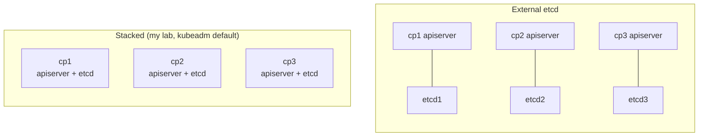
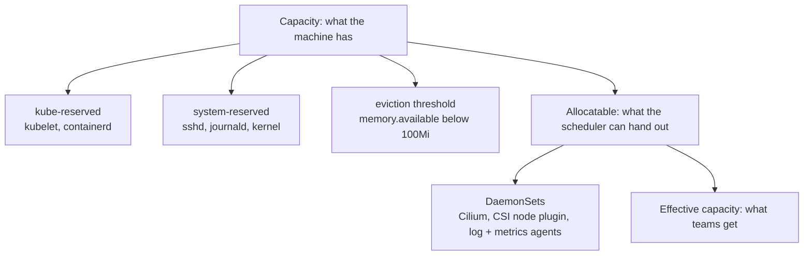

# Day 7 · Sizing for production

**Date:** 2026-11-08 · **Course:** Phase 1, lesson 0013 (the last Phase 1 lesson) · **Status:** notes written, lab to do

**Lab:** [kubeadm HA lab](../../labs/kubeadm-ha/README.md), measured in place (no new build)

**Win:** a sizing sheet I can defend. It goes from demand to effective capacity, then to a
node count and a failure-domain count, and names the resource that runs out first. My
lab's `Allocatable` should match the arithmetic.

## Why

Lab specs are a floor, not a method. Production sizing turns workload demand into node
counts with numbers you can show your working for. It's two separate problems:

| | Control plane | Workers |
|---|---|---|
| Driven by | The fleet: nodes, controllers, watches, API calls | The workloads: summed requests + node overhead |
| Runs out of | etcd fsync latency, apiserver memory | Memory, then CPU, then pod/IP density |
| Survives failure by | Quorum + spreading members | N+1, spreading nodes over racks or zones |

Size both from "what the apps need" and you get it wrong. A small and a huge cluster can
use the *same worker shape*, but not the same control plane.

A cluster is a restaurant. The control plane is the kitchen office: three managers who
must agree (etcd quorum) beat one who can fall ill. The workers are the tables. You size
by seats *booked* (requests), not by how hungry people are (usage), and you keep spare
tables in case one breaks, or a whole room closes.

## Control planes: count first, then size

### How many: etcd quorum

etcd accepts a write only when a majority (`n/2 + 1`) of members agree.

| Members | Quorum | Failures tolerated | Use it for |
|---|---|---|---|
| 1 | 1 | 0 | Labs only |
| 2 | 2 | **0** | Never: worse than 1, two things to break |
| **3** | 2 | **1** | Default for production, up to a few thousand nodes |
| 4 | 3 | 1 | Never: same tolerance as 3, slower writes |
| **5** | 3 | **2** | Large fleets, or still 1-loss tolerant during maintenance |
| 7 | 4 | 3 | Rarely worth the write latency |

Always an **odd** number. Each extra member is another replica every write waits on:
resilience, not capacity.

**Placement is part of the sizing.** Spread members across failure domains: zones in the
cloud, **racks, power feeds or rooms** on-prem. Three control planes in one rack is one
power failure away from no cluster. With 3 members in 2 domains, losing the domain with 2
loses quorum.

### Stacked or external etcd



| Topology | When | Trade-off |
|---|---|---|
| 3 CP, stacked etcd | Default, up to a few thousand nodes | Cheapest; one loss tolerated; apiserver and etcd share a disk |
| 5 CP, stacked | Large fleets needing two-loss tolerance | More voters, same disk discipline |
| 3 CP + 3 external etcd | Very large fleets, multi-datacenter | etcd sized, upgraded and backed up on its own; 6 machines to run |

### How big

Control-plane size tracks the **fleet**, not the apps.

| Cluster size | Control-plane node (rule of thumb) |
|---|---|
| ≤ 10 nodes | 2 vCPU / 8 GiB |
| 11–100 nodes | 4 vCPU / 16 GiB |
| 101–250 nodes | 8 vCPU / 32 GiB |
| 251–500 nodes | 8–16 vCPU / 32–64 GiB |
| up to 5,000 nodes | 16 vCPU / 64 GiB, often external etcd |

The small tiers come from the node-count table the old `kube-up` scripts used. The course
starts at the big end (8 vCPU / 32 GiB up to ~500 nodes). The two agree on the shape: grow
the control plane with the fleet. Measure, then resize.

**What loads the apiserver.** Every controller, operator and `kubectl get -w` holds a
watch, and apiserver memory grows with the number of watches and the request rate.
Apiservers are stateless: scale up first, then add more behind the same VIP. Two series
tell you which side is struggling: `apiserver_request_duration_seconds` (the API) and
`etcd_request_duration_seconds` (the apiserver waiting on etcd).

**etcd is a disk appliance.**

- **SSD/NVMe only.** Every write waits for an `fsync` of the write-ahead log. Keep p99
  WAL fsync **under 10 ms**. Network storage hides latency until it saturates, then the
  whole API slows down.
- **Set the quota on purpose, then alert.** The default `--quota-backend-bytes` is
  **2 GiB**. 8 GiB is common for production. Alert at 70% of it. At the quota etcd raises
  `NOSPACE` and goes **read-only**.
- **Compaction is automatic, defragmentation is not.** See Gotchas.
- **Snapshots leave the node.** Take `etcdctl snapshot save` on a schedule and store it
  somewhere the cluster can't take down with it.

Upstream's tested limits for one cluster: **5,000 nodes, 110 pods per node, 150,000 pods,
300,000 containers.**

## Workers: shape, then count

### What a node really gives you



`allocatable = capacity − kube-reserved − system-reserved − eviction threshold`, then
**effective = allocatable − DaemonSets.** Size from *effective*, never from the instance
spec.

**kubeadm reserves nothing** by default. Only the 100 Mi eviction threshold comes off, so
the scheduler packs pods into memory the kubelet and OS also need. Production nodes need
`kubeReserved` and `systemReserved` set.

GKE's formula is a reasonable one to copy:

| Memory reserved | | CPU reserved | |
|---|---|---|---|
| first 4 GiB | 25% | first core | 6% |
| next 4 GiB | 20% | second core | 1% |
| next 8 GiB | 10% | cores 3–4 | 0.5% each |
| next 112 GiB | 6% | above 4 cores | 0.25% each |
| above 128 GiB | 2% | | |

Plus 100 Mi for eviction. A 4 GiB node keeps ~1.1 GiB for itself, over a quarter. A 32 GiB
node keeps ~3.7 GiB, about 11%. On-prem you can choose rounder, more generous numbers. What
matters is that `Allocatable` matches the number you sized with.

### Pick one node class

Standardise on one worker shape (two at most), not a zoo of special nodes. 16 vCPU / 64 GiB
is a common default. Rule of thumb: **one node should be 5–15% of the fleet.**

| | Fewer, bigger nodes | More, smaller nodes |
|---|---|---|
| Overhead (reserved + DaemonSets) | Smaller share | Bigger share |
| Bin packing large pods | Easier | Large pods may not fit |
| Losing one node | Big blast radius, slow drain | Small blast radius |
| Pods per node | Hits `maxPods` or pod IPs first | Rarely |
| Autoscaling step | Coarse | Fine-grained |

**Match the shape to the workload ratio.** Sum the requests. If pods ask for 1 vCPU per
2 GiB and nodes offer 1:4, CPU runs out with half the memory stranded.

### Pod density: plan `max-pods` and the pod CIDR together

Two limits, which have to be planned as a pair:

- kubelet `maxPods`, **110** by default.
- The node's pod CIDR. In my lab kubeadm splits `podSubnet: 10.244.0.0/16` into a **/24
  per node** (254 addresses), and Cilium's `ipam.mode: kubernetes` uses those.

Raise `maxPods` on big nodes without widening the per-node range, and the scheduler
places pods the CNI can't give an IP. A /16 split into /24s also caps the cluster at 256
nodes.

Density is usually limited by memory before either of those: 110 pods at 384 Mi is ~41 GiB,
but at 1 GiB each it's more than a whole 64 GiB node.

### Requests have to be honest

The formula below is only as good as the requests. Use **`Guaranteed` QoS** (requests =
limits) for critical paths and limits for burst only, and state overcommit per workload
class. Size from p50–p95 per class, not one average: a 384 Mi average can hide a 4 GiB p95.

## Capacity planning

The scheduler places pods by **requests**, never by usage or limits.

```
N = ceil( D / (A_eff × u) ) + 1

D      total demand (summed requests)
A_eff  effective capacity per node (allocatable − DaemonSets)
u      target allocation, 0.7: this *is* the 30% headroom
+1     one lost node
```

Work out CPU and memory separately; the larger N wins.

### Worked example (my own)

300 pods averaging **250m CPU / 512 Mi**: **D = 75 vCPU / 150 GiB**, a 1:2 ratio.
DaemonSets take ~300m / 0.5 GiB per node. Three racks or zones.

| | **A: 8 vCPU / 32 GiB (1:4)** | **B: 16 vCPU / 32 GiB (1:2)** |
|---|---|---|
| Allocatable (GKE reserves) | 7.91 / 28.3 GiB | 15.89 / 28.3 GiB |
| **A_eff** (− DaemonSets) | 7.61 / 27.8 GiB | 15.59 / 27.8 GiB |
| CPU: `75 / (A_eff × 0.7)` | 14.1 → 15 | 6.9 → 7 |
| Memory: `150 / (27.8 × 0.7)` | 7.7 → 8 | 7.7 → 8 |
| **N + 1** (node loss) | **16**, CPU-bound | **9**, memory-bound |
| Memory left idle | ~65% | ~40% |

Shape B needs 9 nodes instead of 16. The workload ratio decided it, not the node size.

### The failure domain sets the count

N+1 covers **a node**. If the promise is "survive a rack (or zone)", the two remaining
thirds must still carry D at the same target:

```
(2/3) × N × A_eff × u ≥ D
```

Shape B: CPU `75 / (15.59 × 0.7 × 2/3)` = 10.3, memory `150 / (27.8 × 0.7 × 2/3)` = 11.6,
so **12 nodes, 4 per rack**, and memory decides it.

| Promise | Shape B count |
|---|---|
| Survive one node | 9 |
| Survive one rack/zone, staying at 70% | **12** |

The failure domain you promise ends up as a hardware order.

**What flips it:** memory-heavy pods. At 1 GiB average instead of 512 Mi, D becomes
300 GiB and memory binds hard (17 nodes with N+1, before rack tolerance). The node shape should
change before the count does.

### Storage and special pools

- **Usable ≠ raw.** Replicated storage divides by the replica count: 3 × 80 GB replicated
  three ways is ~80 GB. Node-local storage (OpenEBS LocalPV) has usable = raw, but a dead
  node takes its volumes with it. That's a durability choice, not a saving.
- **Image cache:** budget ~20 GB of disk per busy worker.
- **Stateful pools:** a tainted database pool isolates noisy neighbours. Start mixed;
  split when a class proves it needs it.

### Keep it honest over time

On-prem there's no node market. HPA scales pods *inside* fixed capacity, the Cluster
Autoscaler needs a provider to call, and servers have a lead time. So capacity planning
is a **quarterly** cadence: measure the requests trend, add headroom, order.

| Watch | PromQL | Act when |
|---|---|---|
| Requests vs allocatable | `sum(kube_pod_container_resource_requests{resource="cpu"}) / sum(kube_node_status_allocatable{resource="cpu"})` | Above 0.7: add nodes |
| Usage vs requests | `sum(rate(container_cpu_usage_seconds_total{container!=""}[5m])) / sum(kube_pod_container_resource_requests{resource="cpu"})` | Far below 1: rightsize |
| Pending pods | `sum(kube_pod_status_phase{phase="Pending"})` | Above 0 for minutes |
| API latency | `histogram_quantile(0.99, sum by (le, verb) (rate(apiserver_request_duration_seconds_bucket[5m])))` | Rising with no traffic change |
| etcd disk | `histogram_quantile(0.99, rate(etcd_disk_wal_fsync_duration_seconds_bucket[5m]))` | Above 10 ms |
| etcd file vs live data | `etcd_mvcc_db_total_size_in_bytes` vs `etcd_mvcc_db_total_size_in_use_in_bytes` | File above 70% of quota, or live data under half the file: defrag |
| API overload | `rate(apiserver_flowcontrol_rejected_requests_total[5m])` | Above 0 |

## The sizing sheet

| Step | Fill in | My example (shape B) | My lab |
|---|---|---|---|
| 1 · Inventory | services × replicas | 300 pods | |
| 2 · Requests | p50–p95 per class, not limits | 250m / 512 Mi | |
| 3 · Node class | one shape | 16 vCPU / 32 GiB | 2 vCPU / 4 GiB |
| 4 · A_eff | allocatable − DaemonSets | 15.59 / 27.8 GiB | |
| 5 · Demand D | Σ requests | 75 vCPU / 150 GiB | |
| 6 · Count | `ceil(D / (A_eff × 0.7)) + 1` | 9, memory-bound | |
| 7 · Failure domain | what must survive | 12 across 3 racks | |
| 8 · Verify | requests / allocatable | ≈ 0.7 | |

## Verify (on the Phase 1 lab)

My lab is smaller than the course's floor: 3 control planes at 2 vCPU / 3 GiB and
3 workers at 2 vCPU / 4 GiB.

```bash
# 1. Capacity vs allocatable: expect only 100 Mi difference (kubeadm reserves nothing)
kubectl get nodes -o custom-columns=NODE:.metadata.name,\
CPU:.status.capacity.cpu,ALLOC_CPU:.status.allocatable.cpu,\
MEM:.status.capacity.memory,ALLOC_MEM:.status.allocatable.memory
kubectl get --raw /api/v1/nodes/kyl-w1/proxy/configz \
  | jq '.kubeletconfig | {kubeReserved, systemReserved, evictionHard, maxPods}'

# 2. Pod CIDR per node: should be a /24 out of 10.244.0.0/16
kubectl get nodes -o custom-columns=NODE:.metadata.name,POD_CIDR:.spec.podCIDR

# 3. What's already booked (kubectl top needs metrics-server)
kubectl describe nodes | grep -A8 "Allocated resources"

# 4. etcd size, live data, leader; then fsync from the metrics port kubeadm sets
E='etcdctl --cacert /etc/kubernetes/pki/etcd/ca.crt --cert /etc/kubernetes/pki/etcd/server.crt --key /etc/kubernetes/pki/etcd/server.key'
kubectl -n kube-system exec etcd-kyl-cp1 -- sh -c "$E endpoint status --cluster -w table"
vagrant ssh kyl-cp1 -c "curl -s http://127.0.0.1:2381/metrics \
  | grep -E 'etcd_disk_wal_fsync_duration_seconds_(sum|count)'"   # sum/count = mean fsync

# 5. Defrag one member at a time, followers first, leader last (reorder to match)
for cp in kyl-cp2 kyl-cp3 kyl-cp1; do
  kubectl -n kube-system exec etcd-$cp -- sh -c "$E defrag" &&
  kubectl -n kube-system exec etcd-$cp -- sh -c "$E endpoint health"
done
```

**Reserve resources on one worker** and check that allocatable drops by exactly that
amount. GKE's formula for a 2 vCPU / 4 GiB node gives about 70m CPU and 1 GiB memory.

```bash
vagrant ssh kyl-w1
grep -E 'kubeReserved|systemReserved' /var/lib/kubelet/config.yaml   # must be empty
sudo tee -a /var/lib/kubelet/config.yaml <<'EOF'
kubeReserved:
  cpu: 50m
  memory: 512Mi
systemReserved:
  cpu: 20m
  memory: 512Mi
EOF
sudo systemctl restart kubelet && exit
kubectl get node kyl-w1 -o jsonpath='{.status.allocatable}{"\n"}'
```

| Measured | kyl-w1 before | kyl-w1 after |
|---|---|---|
| Allocatable CPU | | |
| Allocatable memory | | |
| Pod CIDR | | — |
| etcd DB size / in use | | after defrag: |
| Mean WAL fsync | | — |

## Gotchas

- **Sizing from limits, not requests.** The cluster looks full while using a fraction of
  its CPU.
- **Forgetting reserved + DaemonSets.** Size from effective capacity. On small nodes the
  overhead is a quarter of the machine.
- **kubeadm reserves nothing.** Allocatable is capacity minus 100 Mi until `kubeReserved`
  and `systemReserved` are set, ideally in the `KubeletConfiguration` passed to
  `kubeadm init`/`join`. Hand-appending to `config.yaml` with a duplicate key stops the
  kubelet.
- **`maxPods` and the pod CIDR tuned separately.** The scheduler accepts pods the network
  can't address.
- **Promising rack loss but sizing for node loss.** 9 vs 12 nodes in my example.
- **Trusting averages.** Size per workload class from p95.
- **Counting raw storage as usable.** Divide replicated storage by its replica count.
- **2 or 4 etcd members tolerate no more failures than 1 or 3.** Always odd.
- **etcd's quota counts the file, not the live data.** The apiserver compacts old
  revisions every 5 minutes, but compaction only frees space *inside* the file. Only
  `etcdctl defrag` shrinks it, and nothing runs that by default. Each member blocks while
  it defrags: one at a time, leader last, in a window. `NOSPACE` recovery: compact,
  defrag, `etcdctl alarm disarm`.
- **Stacked etcd shares a disk with everything else on the control plane.** Noisy logs or
  image pulls show up as API latency.

## My thinking

- **The node shape matters more than the node size.** Matching the 1:2 request ratio cut
  my example from 16 nodes to 9 at the same memory per node.
- **What happens to the 70% target during a failure is a policy choice.** I first checked
  zone loss at 100% packing: 6 nodes "fit" 75 vCPU, so 9 looked enough. The course keeps
  the 70% target *after* the loss, which gives 12. Running a damaged cluster at 100% means
  no room for a rollout or a spike during the outage. 12 is the honest number, 9 is the
  budget number, and it should be written down which one was promised.
- **The cloud flips two habits.** On EKS (what I run at work) the control plane is a fee,
  not machines: you pick regional vs zonal for the SLA, not a size. Node advice flips too:
  with Karpenter you describe a *range* of shapes and let it choose, instead of
  standardising on one class. The node image sets reservations, often more aggressively
  (EKS reserves memory from pod density, `255Mi + 11Mi × maxPods`, to check on AL2023), so
  read `Allocatable`, never the instance spec. N+1 runs per AZ, and idle headroom becomes
  an autoscaler setting rather than a hardware order.
- **Padded requests are the cheapest capacity.** Usage-vs-requests is the first number I'd
  check on an existing cluster before buying more nodes.

## Lab TODO

- [ ] Fill in the measurements table and the "My lab" column of the sizing sheet.
- [ ] Set `kubeReserved`/`systemReserved` in the lab's `KubeletConfiguration`
      (`scripts/kubeadm-config.sh`) instead of by hand.
- [ ] Defrag the lab's etcd and record the file size before and after.
- [ ] Schedule an off-node `etcdctl snapshot save`.
- [ ] Install metrics-server so `kubectl top` and usage-vs-requests work.

## References

- Considerations for large clusters: https://kubernetes.io/docs/setup/best-practices/cluster-large/
- HA topology options: https://kubernetes.io/docs/setup/production-environment/tools/kubeadm/ha-topology/
- Reserve compute resources: https://kubernetes.io/docs/tasks/administer-cluster/reserve-compute-resources/
- Pod QoS classes: https://kubernetes.io/docs/concepts/workloads/pods/pod-qos/
- etcd hardware: https://etcd.io/docs/v3.5/op-guide/hardware/
- etcd maintenance (compaction, defrag, quota): https://etcd.io/docs/v3.5/op-guide/maintenance/
- etcd FAQ, cluster size: https://etcd.io/docs/v3.5/faq/
- GKE node sizing: https://cloud.google.com/kubernetes-engine/docs/concepts/plan-node-sizes
