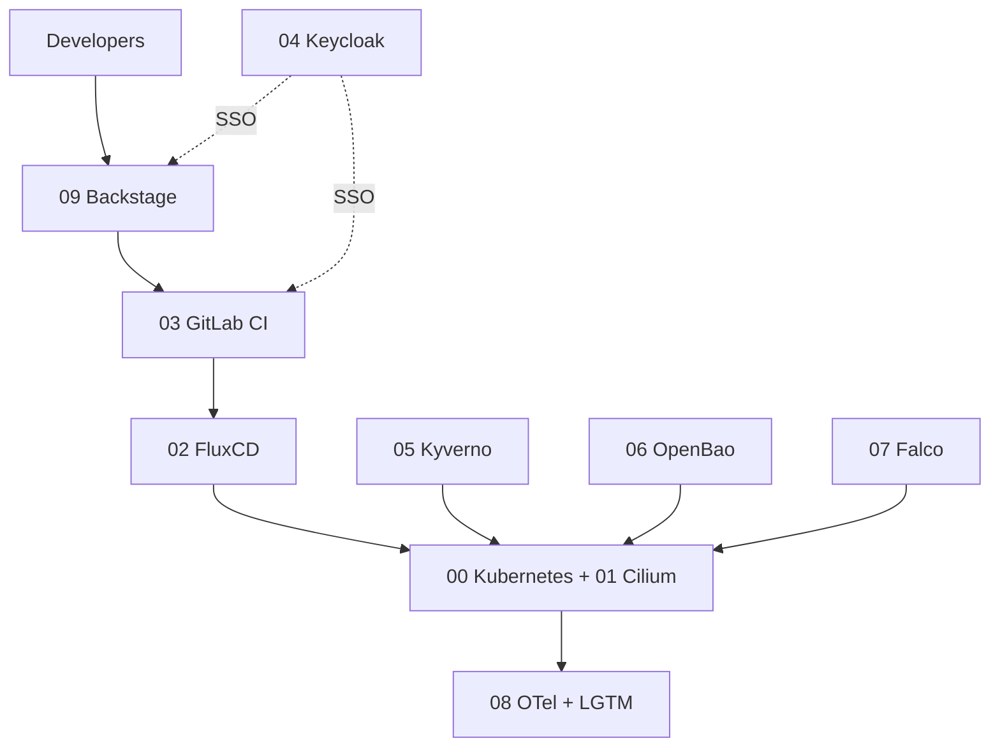

# Platform Engineering Bootcamp

Building an internal developer platform from scratch on Kubernetes, one component
at a time, during a Platform Engineering Bootcamp (Oct 2026 – May 2027).

Everything here is my own work. Course slides and instructor material are not published.

**Start here:** [What is platform engineering?](00-intro-platform-engineering.md)

## Platform

| # | Module | Component | Status |
|---|--------|-----------|--------|
| 00 | [Kubernetes](modules/00-kubernetes/README.md) | Cluster foundation | ⬜ |
| 01 | [Service mesh](modules/01-cilium/README.md) | Cilium | ⬜ |
| 02 | [GitOps](modules/02-fluxcd/README.md) | FluxCD | ⬜ |
| 03 | [SCM](modules/03-gitlab/README.md) | GitLab | ⬜ |
| 04 | [IAM](modules/04-keycloak/README.md) | Keycloak | ⬜ |
| 05 | [Policy](modules/05-kyverno/README.md) | Kyverno | ⬜ |
| 06 | [Secrets](modules/06-openbao/README.md) | OpenBao | ⬜ |
| 07 | [Runtime security](modules/07-falco/README.md) | Falco | ⬜ |
| 08 | [Observability](modules/08-otel-lgtm/README.md) | OpenTelemetry + Loki, Grafana, Tempo, Mimir | ⬜ |
| 09 | [Developer portal](modules/09-backstage/README.md) | Backstage | ⬜ |

⬜ not started · 🟨 in progress · ✅ done

Module order follows the component list, not necessarily the session order.

## How the platform fits together

