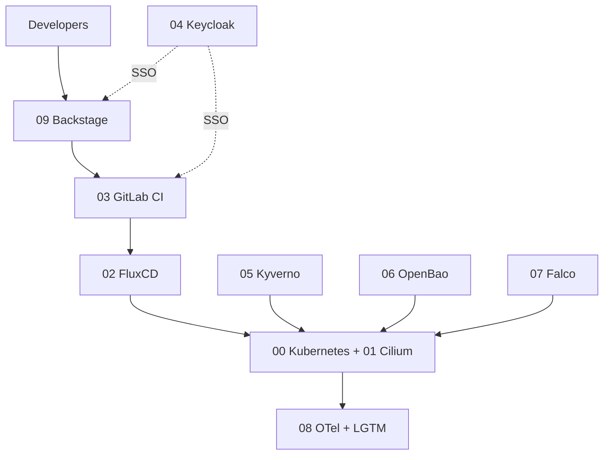

import { Card, CardGrid, LinkCard } from '@astrojs/starlight/components';

## How the platform fits together

## Modules

⬜ not started · 🟨 in progress · ✅ done

<CardGrid>
  <LinkCard title="⬜ 00 · Kubernetes" description="Cluster foundation" href="/platform-engineering-bootcamp/modules/00-kubernetes/" />
  <LinkCard title="⬜ 01 · Cilium" description="eBPF networking and service mesh" href="/platform-engineering-bootcamp/modules/01-cilium/" />
  <LinkCard title="⬜ 02 · FluxCD" description="GitOps continuous delivery" href="/platform-engineering-bootcamp/modules/02-fluxcd/" />
  <LinkCard title="⬜ 03 · GitLab" description="Source control and CI" href="/platform-engineering-bootcamp/modules/03-gitlab/" />
  <LinkCard title="⬜ 04 · Keycloak" description="Identity and SSO" href="/platform-engineering-bootcamp/modules/04-keycloak/" />
  <LinkCard title="⬜ 05 · Kyverno" description="Policy as code" href="/platform-engineering-bootcamp/modules/05-kyverno/" />
  <LinkCard title="⬜ 06 · OpenBao" description="Secrets management" href="/platform-engineering-bootcamp/modules/06-openbao/" />
  <LinkCard title="⬜ 07 · Falco" description="Runtime security" href="/platform-engineering-bootcamp/modules/07-falco/" />
  <LinkCard title="⬜ 08 · OpenTelemetry + LGTM" description="Loki, Grafana, Tempo, Mimir" href="/platform-engineering-bootcamp/modules/08-otel-lgtm/" />
  <LinkCard title="⬜ 09 · Backstage" description="Developer portal" href="/platform-engineering-bootcamp/modules/09-backstage/" />
</CardGrid>

Module order follows the component list, not necessarily the session order.

## About

<CardGrid>
  <Card title="My own work" icon="pencil">
    Notes are written after each lab. Course slides and instructor material are not published.
  </Card>
  <Card title="Own cluster" icon="laptop">
    Every lab runs on a local kind cluster, never on a work environment.
  </Card>
</CardGrid>
